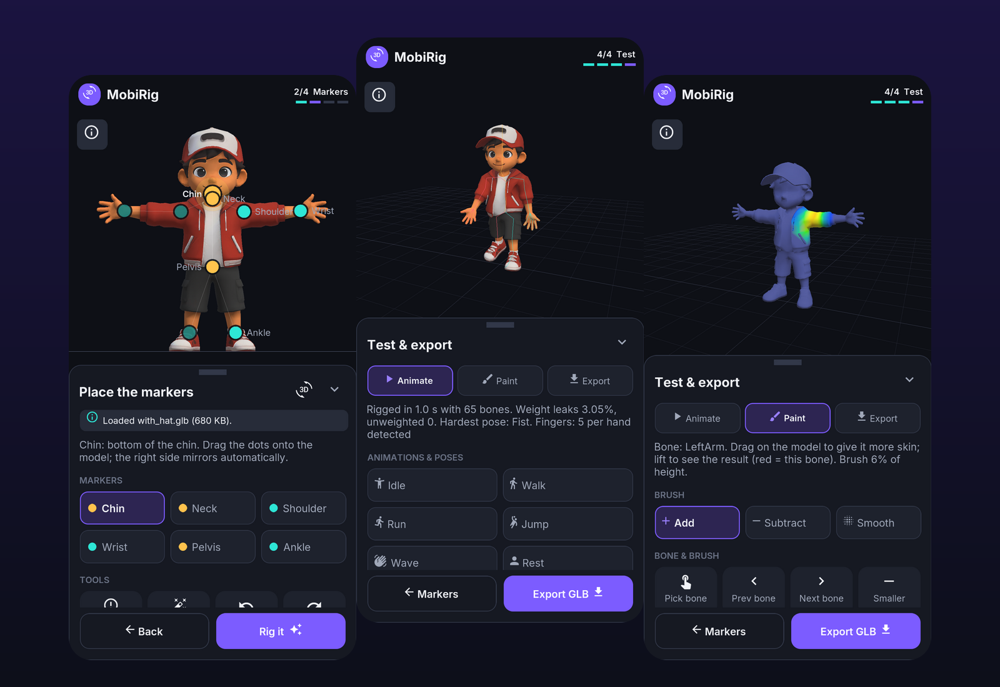
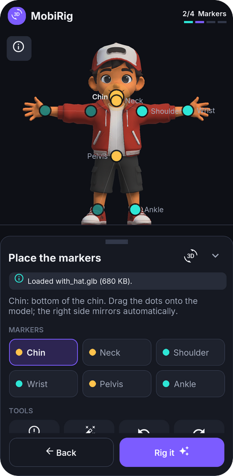
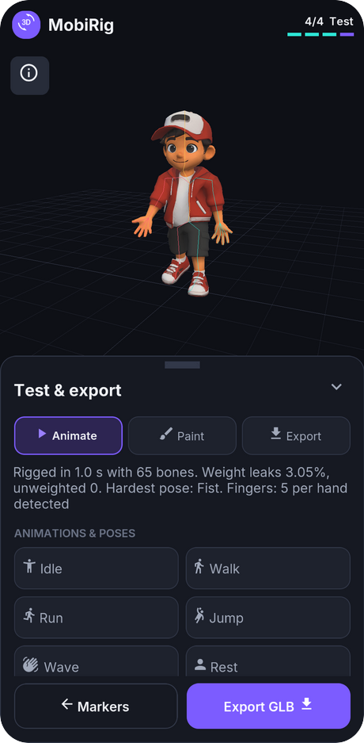
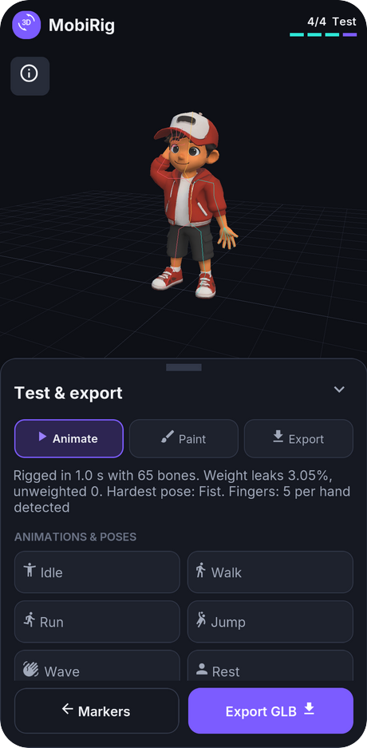
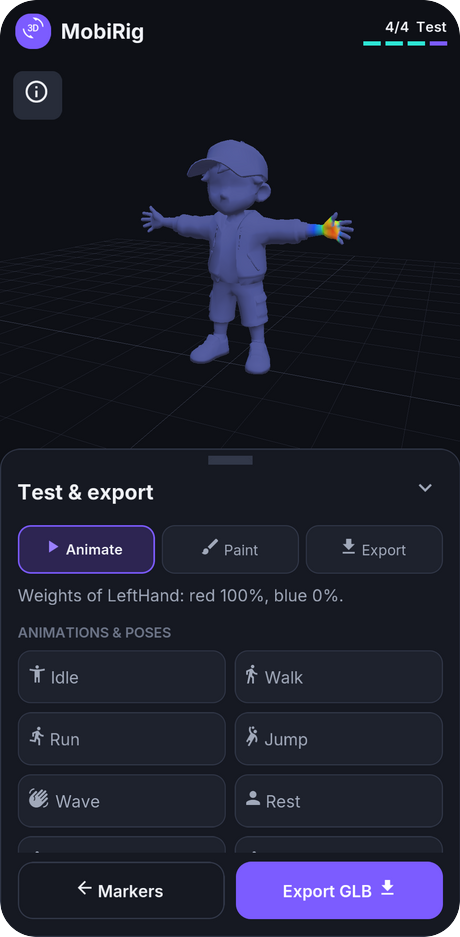
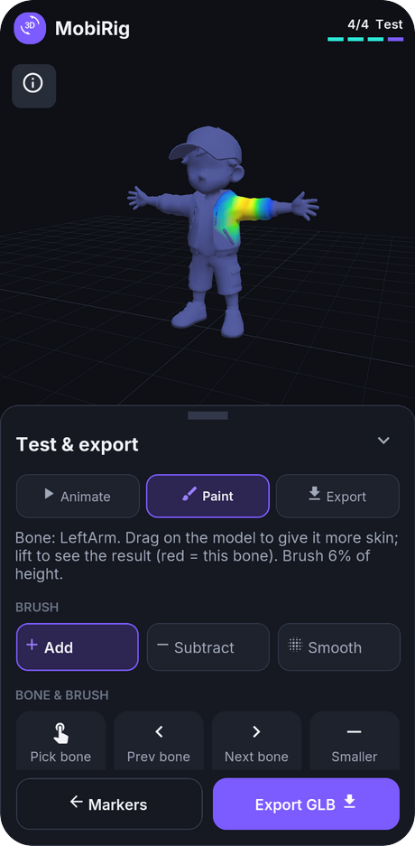
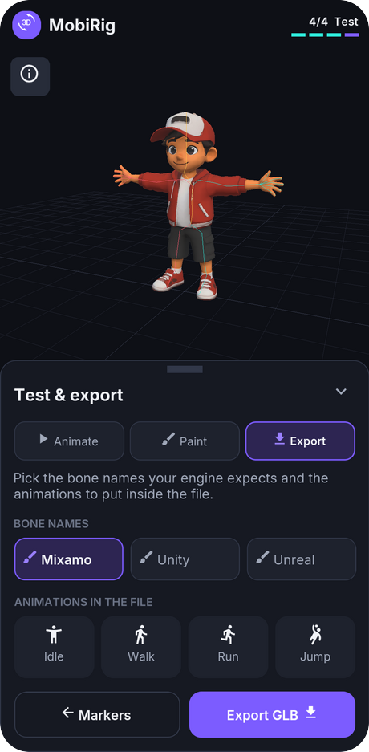

# MobiRig

### Rig any 3D character in minutes — right on your phone.

Drop in a character, place a few dots, and get an animation-ready model.
Fully offline. Your models never leave your device.

**[⬇ Download the latest APK](../../releases/latest)**

---

## ✨ Features

### 🎯 Rigging in a few taps
Open a 3D character and MobiRig suggests where the head, shoulders, wrists, hips and ankles are. Fine-tune each dot with a built-in magnifier, then tap **Rig it**.

### 🖐 Fingers that really bend
Every finger moves on its own. Make a fist, relax the hand, wave hello — hands look natural instead of rubbery.

### 🏃 Test before you export
Try ready-made poses and animations on your character straight away: **Idle, Walk, Run, Jump and Wave**. You can also import a motion made for another character and watch it play on yours.

  
  &nbsp;
  

### 🎨 Paint the skin
Not happy with how a shoulder or hip bends? Paint it better with **Add**, **Subtract** and **Smooth** brushes, see the result in colour, and mirror your strokes left and right.

  
  &nbsp;
  

### 📦 Export for your favourite engine
Choose bone names for **Mixamo**, **Unity** or **Unreal** and put the animations right inside the file.

### 💾 Never lose your work
Undo and redo any marker move. Open the same character again later and your markers are right where you left them.

### 👆 Made for touch
Large buttons, a clean dark design, and a short tip whenever you hold an icon.

---

## 🚀 Get started

1. Download the APK from the [Releases](../../releases/latest) page and install it.
2. Open a 3D character (`.glb`).
3. Check the dots, tap **Rig it**, try the animations.
4. Tap **Export GLB**.

---

## 📄 License

Apache License 2.0 — see [LICENSE](LICENSE).
